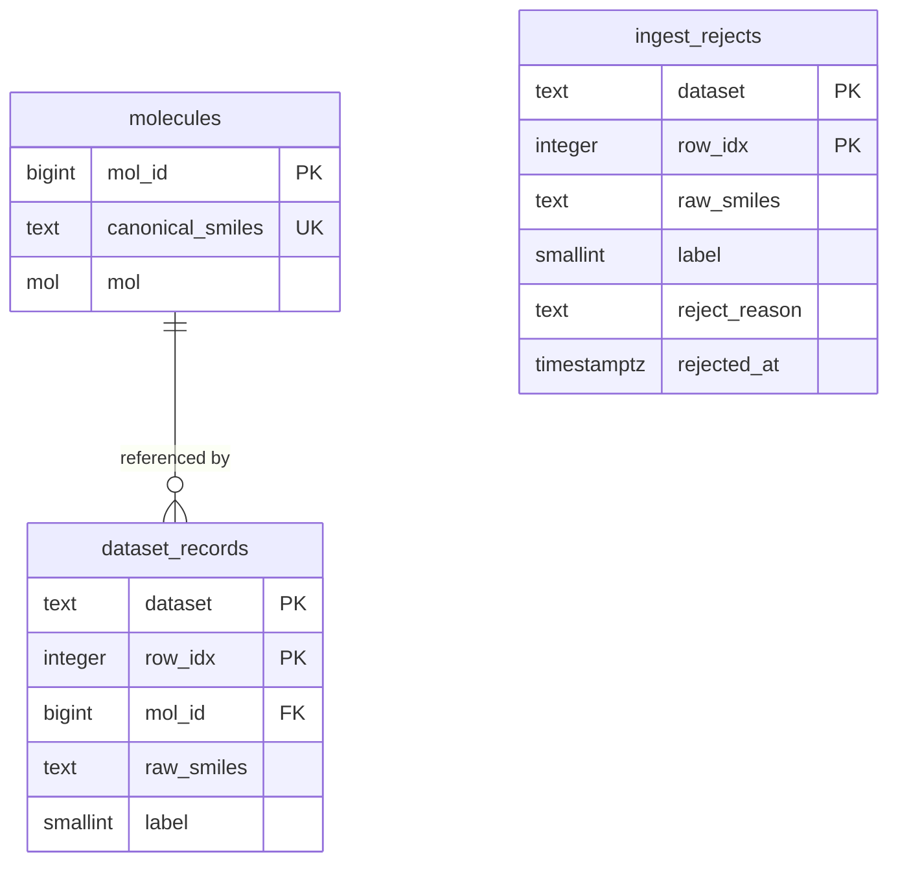

# Substructure search over molecules in PostgreSQL: what the planner can't see

This project tests a practical tradeoff in cheminformatics databases: parsing SMILES at query time is slower than storing RDKit's parsed `mol` value, but stored structures take substantially more space—and PostgreSQL's planner does not accurately estimate RDKit substructure predicates.

| Headline result | Measurement |
|---|---:|
| Parse SMILES per row | ~0.30–0.35 ms/row |
| Search using stored `mol` | ~0.06 ms/row (about 5–6× faster) |
| Storage per value | 357 B for `mol` vs 52 B for SMILES (~6.9× more) |
| Planner estimate for `@>` | 2 rows estimated vs 1,367 actual |

These are early measurements on one machine and a 2,039-row dataset. See the [findings](#findings-and-caveats) and [limitations](#limitations) for the caveats.

## Quickstart

Requirements: Docker Desktop with the WSL2 backend and Docker Compose v2. From the repository root, start the database:

```powershell
docker compose up --build -d
```

In the same terminal, run the schema, stage the CSV, and load it:

```powershell
docker compose exec -T db psql -U chem -d chemdb -f /sql/01_schema.sql
docker compose exec -T db psql -U chem -d chemdb -f /sql/02_stage_bbbp.sql
docker compose exec -T db psql -U chem -d chemdb -f /sql/02_load_bbbp.sql
```

The final command prints the reconciliation counts:

```text
 staged | loaded | rejected | distinct_molecules
--------+--------+----------+-------------------
   2039 |   2039 |        0 |              1975
```

This is a first-run flow against an empty database volume. The schema script is not a reset/migration script; re-running it against an already initialized volume will fail because the tables already exist. The named `pgdata` volume preserves your database when the container is recreated. Do not remove it unless you intend to discard the database.

## Architecture



`molecules` stores one parsed structure per canonical SMILES, while `dataset_records` stores each dataset row and its source-specific annotations; this avoids storing the expensive structure repeatedly when records refer to the same molecule. `ingest_rejects` keeps invalid or empty structures with their source row and reason, rather than silently dropping them.

## Findings and caveats

| Measured claim | Caveat |
|---|---|
| Parsing SMILES per row costs about 0.30–0.35 ms/row; querying a stored `mol` costs about 0.06 ms/row (roughly 5–6× faster). | A small-dataset, single-machine microbenchmark; timings vary by query, hardware, and run. |
| A stored `mol` value uses about 357 B versus 52 B for the SMILES value (~6.9× more storage). | Per-value measurements, not total table/index size; PostgreSQL row and index overhead are additional. |
| The `@>` substructure operator uses PostgreSQL's generic `contsel` selectivity estimator: the plan estimates 0.1% of rows (`rows=2`) where 1,367 match. The cartridge functions are also priced at `procost = 1`. | The estimate and function cost are for the observed plan and installed extension; they are not a guarantee about every predicate or query. |
| The checked-in BBBP CSV has 2,039 data rows, with 0 unparseable or empty-molecule rejects in the load. It produces 1,975 distinct molecules. | The original MoleculeNet paper's Table 1 reports 2,053 BBBP compounds, not 2,050. The paper's benchmark count and this repository's CSV are not the same version/count; record the exact source artifact when comparing results. ([Wu et al., 2018, Table 1](https://pmc.ncbi.nlm.nih.gov/articles/PMC5868307/)) |
| There are 64 duplicate records across 60 molecule groups; 10 groups contain conflicting labels. | Duplicate groups are based on the canonicalized molecule identity, not byte-identical input SMILES. |
| About 76.5% of labels are positive. ROC-AUC is the MoleculeNet-recommended metric for BBBP; accuracy alone can be misleading with this class imbalance. | Keep the split strategy fixed and report class counts; a metric alone does not address leakage or split bias. |
| RDKit parses an empty SMILES string as a valid zero-atom molecule. | A `mol IS NOT NULL` check alone would admit it. The loader also checks atom count and records empty structures in `ingest_rejects`. |

## Environment and reproducibility

- **Host:** Windows with Docker Desktop using the WSL2 backend.
- **Database:** PostgreSQL 15 (`postgres:15-bookworm`).
- **RDKit:** the PostgreSQL RDKit cartridge is installed from Debian's `postgresql-15-rdkit` package in [docker/Dockerfile](docker/Dockerfile). The runtime `rdkit_version()` output observed for this setup is `0.73.0`; retain that literal output in benchmark notes rather than assuming it is the upstream RDKit release number. The package is not version-pinned in the Dockerfile, so a future image build may install a different package revision.
- **Persistent database storage:** Compose uses a named `pgdata` volume for `/var/lib/postgresql/data`. Keeping PostgreSQL's data directory in a Docker-managed volume avoids binding the live database files to a Windows/WSL workspace path and lets the database survive container replacement.
- **Shared memory:** `shm_size: 1g` enlarges the container's `/dev/shm` beyond Docker's small default. PostgreSQL uses shared memory for database operations; the larger allocation avoids an unnecessarily tight container limit as query and worker needs grow.
- **Dataset artifact:** the checked-in [`data/bbbp.csv`](data/bbbp.csv) contains 2,039 data rows (excluding its header). The primary MoleculeNet paper reports 2,053 BBBP compounds; do not describe the checked-in file as the paper's exact 2,050-row dataset without identifying and reconciling the source version.

To confirm the runtime version after startup:

```powershell
docker compose exec -T db psql -U chem -d chemdb -c "SELECT version(); SELECT rdkit_version();"
```

## Limitations

- The current dataset has only about 2,000 rows.
- Measurements come from one machine; expect approximately ±10–15% timing noise.
- Indexes for substructure search have not been built yet, so these results do not represent indexed search performance.
- The current findings are not a scale-out or production workload evaluation.

## Roadmap

- **Week 2:** build and evaluate RDKit substructure indexes.
- **Week 2:** test PostgreSQL parallel workers and measure their effect on the search workload.
- **Week 2:** run the benchmark at 10 million rows and report throughput, storage, and planner estimates.

## Project structure

- `docker/` — PostgreSQL image setup.
- `sql/` — schema, staging, and BBBP load scripts.
- `data/` — checked-in benchmark dataset.
- `docs/` — project journal, roadmap, and decision notes.

## License

This repository is intentionally kept lightweight and open for rapid iteration.
