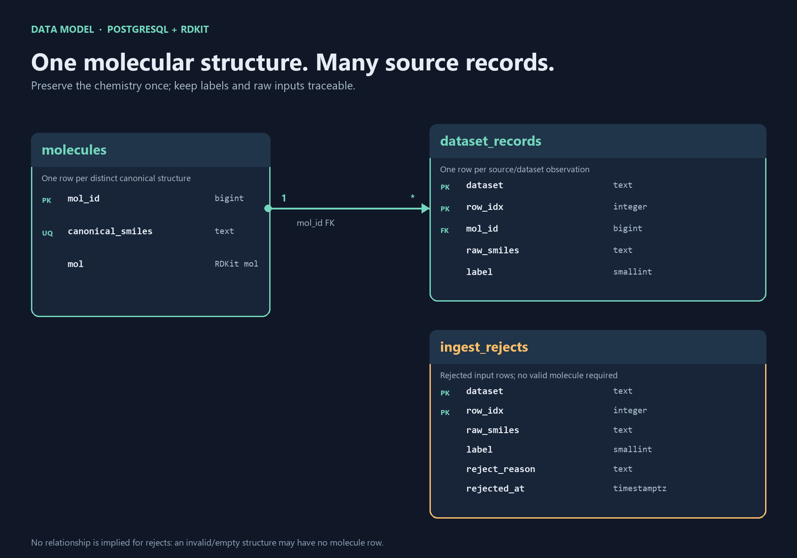

# Substructure search over molecules in PostgreSQL: what the planner can't see

This project tests a practical tradeoff in cheminformatics databases: parsing SMILES at query time is slower than storing RDKit's parsed `mol` value, but stored structures take substantially more space—and PostgreSQL's planner does not accurately estimate RDKit substructure predicates.

| Headline result | Measurement |
|---|---:|
| Parse SMILES per row | ~0.30–0.35 ms/row |
| Search using stored `mol` | ~0.06 ms/row (about 5–6× faster) |
| Storage per value | 357 B for `mol` vs 52 B for SMILES (~6.9× more) |
| Planner estimate for `@>` | 2 rows estimated vs 1,367 actual |

These are early measurements on one machine and a 2,039-row dataset. See the [findings](#findings-and-caveats) and [limitations](#limitations) for the caveats.

## Quickstart

Requirements: Windows, Docker Desktop with the WSL2 backend, Docker Compose v2, and PowerShell 7 or later. A local `.env` file is optional; copy `.env.example` to `.env` and adjust the development-only credentials if desired. Docker Compose reads `.env` automatically.

The BBBP CSV is not distributed by this repository because its upstream license is marked unknown. On a fresh checkout, download the [pinned 2,039-row Hugging Face artifact](https://huggingface.co/datasets/scikit-fingerprints/MoleculeNet_BBBP/tree/86db3f465c006b230b1e5af9032a1e05be4db618):

```powershell
.\scripts\Download-BBBP.ps1
```

The downloader verifies the pinned file checksum, its `SMILES,label` columns, and the 2,039-row count; it refuses to overwrite an existing local file unless `-Force` is supplied. This pinned artifact's row values and ordering match the local baseline. The loader records its URL, revision, citations, unknown license, and the downloaded file's checksum in `datasets`.

The one-command clean rebuild is:

```powershell
.\scripts\Verify-Rebuild.ps1
```

It rebuilds the image and database from scratch, waits for PostgreSQL, executes the three SQL files with `ON_ERROR_STOP`, and verifies `2039|2039|0|1975` (staged, loaded, rejected, distinct molecules). It deletes the Compose named volumes via `docker compose down -v`; use `-WhatIf` to preview or `-Confirm:$false` to suppress the confirmation prompt.

To run the SQL manually against a fresh database instead, start Compose and run:

```powershell
docker compose up --build -d
docker compose exec -T db psql -v ON_ERROR_STOP=1 -U chem -d chemdb -f /sql/01_schema.sql
docker compose exec -T db psql -v ON_ERROR_STOP=1 -U chem -d chemdb -f /sql/02_stage_bbbp.sql
$hash = (Get-FileHash .\data\bbbp.csv -Algorithm SHA256).Hash.ToLowerInvariant()
docker compose exec -T db psql -v ON_ERROR_STOP=1 -v "file_sha256=$hash" -U chem -d chemdb -f /sql/02_load_bbbp.sql
```

Manual commands above show the default credentials; use matching values from `.env` if you customized them. The schema is a first-run script, not a migration. The named `pgdata` volume preserves the database when the container is recreated; do not run `docker compose down -v` unless you intend to discard it.

## Architecture



`molecules` stores one parsed structure per canonical SMILES, while `dataset_records` stores each source row and its annotations. The `datasets` registry records source URL, citation, license, version, checksum, and load time; foreign keys prevent records or rejects from referring to a misspelled dataset. `ingest_rejects` retains invalid or empty structures with their source row and reason.

The `v_molecule_identity` view computes molecular formula and average molecular weight on demand rather than widening every molecule row. InChIKey is not stored; check whether the installed cartridge provides an InChI function before adding an on-demand projection. The `v_molecule_fingerprints` view exposes Morgan bit fingerprints for similarity queries. Quality views include `v_label_balance`, `v_duplicate_groups`, `v_label_conflicts`, and `v_load_summary`.

Runnable examples are in [`sql/queries/`](sql/queries/): the benzene substructure count and a top-10 Tanimoto similarity ranking for an aspirin query. The similarity example computes Morgan fingerprints on demand and is intended as a correctness/example query, not an indexed large-scale search. Run them with `psql -f` after the database is loaded.

## Findings and caveats

| Measured claim | Caveat |
|---|---|
| Parsing SMILES per row costs about 0.30–0.35 ms/row; querying a stored `mol` costs about 0.06 ms/row (roughly 5–6× faster). | A small-dataset, single-machine microbenchmark; timings vary by query, hardware, and run. |
| A stored `mol` value uses about 357 B versus 52 B for the SMILES value (~6.9× more storage). | Per-value measurements, not total table/index size; PostgreSQL row and index overhead are additional. |
| The `@>` substructure operator uses PostgreSQL's generic `contsel` selectivity estimator: the plan estimates 0.1% of rows (`rows=2`) where 1,367 match. The cartridge functions are also priced at `procost = 1`. | The estimate and function cost are for the observed plan and installed extension; they are not a guarantee about every predicate or query. |
| The 2,039-row BBBP artifact used for the baseline produced 0 unparseable or empty-molecule rejects and 1,975 distinct molecules. | The original MoleculeNet paper's Table 1 reports 2,053 BBBP compounds, not 2,050. The paper's benchmark count and this normalized artifact are not the same version/count; record the exact source artifact when comparing results. ([Wu et al., 2018, Table 1](https://pmc.ncbi.nlm.nih.gov/articles/PMC5868307/)) |
| There are 64 duplicate records across 60 molecule groups; 10 groups contain conflicting labels. | Duplicate groups are based on the canonicalized molecule identity, not byte-identical input SMILES. |
| About 76.5% of labels are positive. ROC-AUC is the MoleculeNet-recommended metric for BBBP; accuracy alone can be misleading with this class imbalance. | Keep the split strategy fixed and report class counts; a metric alone does not address leakage or split bias. |
| RDKit parses an empty SMILES string as a valid zero-atom molecule. | A `mol IS NOT NULL` check alone would admit it. The loader also checks atom count and records empty structures in `ingest_rejects`. |

## Environment and reproducibility

- **Host:** Windows with Docker Desktop using the WSL2 backend.
- **Database:** PostgreSQL 15 (`postgres:15-bookworm`).
- **RDKit:** the PostgreSQL RDKit cartridge is installed from Debian's `postgresql-15-rdkit` package in [docker/Dockerfile](docker/Dockerfile). The runtime `rdkit_version()` output observed for this setup is `0.73.0`; retain that literal output in benchmark notes rather than assuming it is the upstream RDKit release number. The package is not version-pinned in the Dockerfile, so a future image build may install a different package revision.
- **Persistent database storage:** Compose uses a named `pgdata` volume for `/var/lib/postgresql/data`. Keeping PostgreSQL's data directory in a Docker-managed volume avoids binding the live database files to a Windows/WSL workspace path and lets the database survive container replacement.
- **Shared memory:** `shm_size: 1g` enlarges the container's `/dev/shm` beyond Docker's small default. PostgreSQL uses shared memory for database operations; the larger allocation avoids an unnecessarily tight container limit as query and worker needs grow.
- **Dataset artifact:** `scripts/Download-BBBP.ps1` fetches the pinned `scikit-fingerprints/MoleculeNet_BBBP` CSV revision. Its 2,039 rows are not the same count as the 2,053 compounds reported in the primary MoleculeNet paper; record the exact artifact and checksum when comparing results. The dataset card marks its license unknown, so the CSV is ignored by Git.

To confirm the runtime version after startup:

```powershell
docker compose exec -T db psql -U chem -d chemdb -c "SELECT version(); SELECT rdkit_version();"
```

## Data validation

Validation happens in two layers.

Schema constraints: NOT NULL on SMILES and labels, UNIQUE canonical SMILES
per molecule, a foreign key from records to molecules, and composite primary
keys that make loads re-runnable.

Loader checks ([sql/02_load_bbbp.sql](sql/02_load_bbbp.sql)):
- A SMILES that fails RDKit parsing or sanitization is quarantined in
  ingest_rejects as parse_failed.
- A SMILES that parses to a molecule with zero atoms is quarantined as
  empty_molecule.
- Duplicate structures are collapsed by canonical SMILES; every source record
  is preserved.
- The load aborts and rolls back if staged rows do not equal loaded plus
  rejected rows.

Not validated (yet): label values, salts/charge/stereo standardization, and
label conflicts. Conflicts are reported, not resolved: 10 molecules in BBBP
carry conflicting labels.
Check which identity and fingerprint functions are available in the installed cartridge with `\df *mol*`, `\df *inchi*`, `\df *fp*`, and `\df *tanimoto*`. In the observed environment, `\dx` reported extension version `4.3.0` and `rdkit_version()` returned `0.73.0`; those values are recorded as observed runtime output, not inferred upstream release versions.

## Limitations

- The current dataset has only about 2,000 rows.
- Measurements come from one machine; expect approximately ±10–15% timing noise.
- Indexes for substructure search have not been built yet, so these results do not represent indexed search performance.
- The current findings are not a scale-out or production workload evaluation.

## Roadmap

- **Week 2:** build and evaluate RDKit substructure indexes.
- **Week 2:** test PostgreSQL parallel workers and measure their effect on the search workload.
- **Week 2:** run the benchmark at 10 million rows and report throughput, storage, and planner estimates.

## Project structure

- `docker/` — PostgreSQL image setup.
- `sql/` — schema, staging, and BBBP load scripts.
- `data/` — local, Git-ignored BBBP dataset artifact.
- `scripts/` — dataset download and destructive clean-rebuild verification workflows.
- `docs/` — project journal, roadmap, and decision notes.
- [Publishing kit](docs/publishing-kit.md) — article, carousel, Shorts, and visual assets.

## License

This repository is intentionally kept lightweight and open for rapid iteration.
