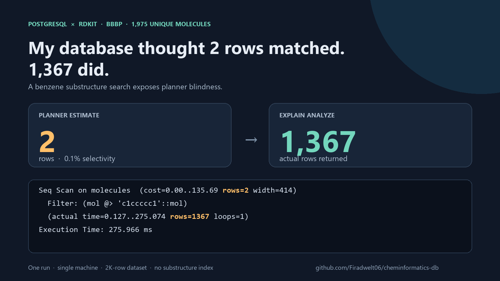
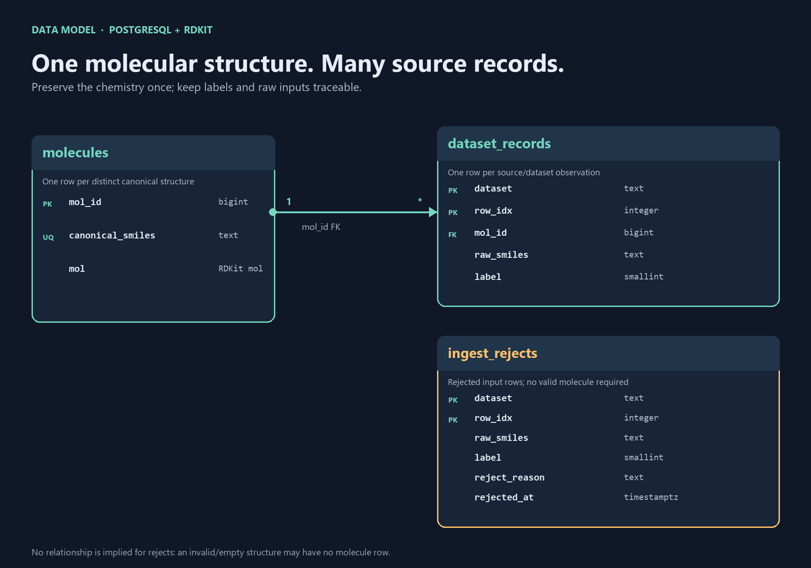
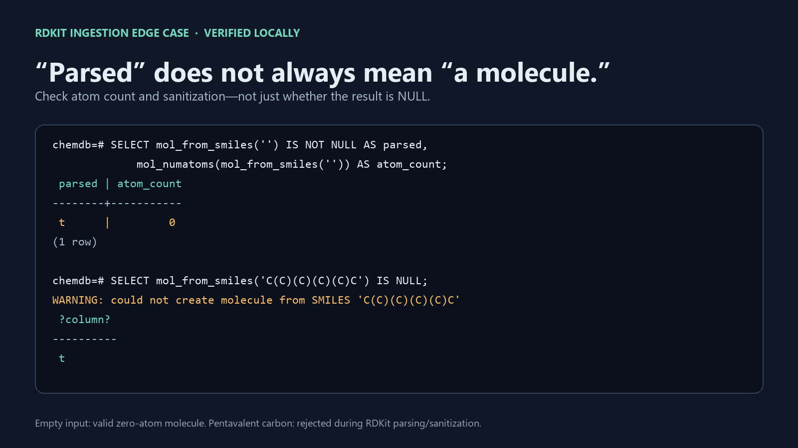
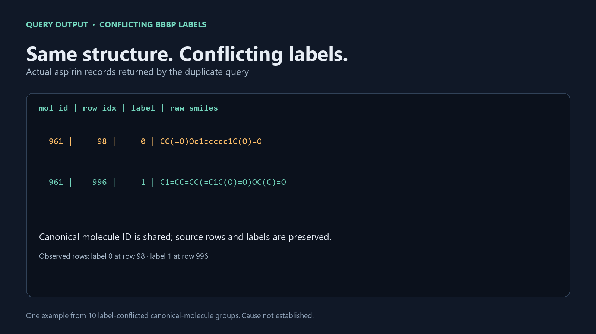

# My database thought 2 rows matched. 1,367 did.



I ran a substructure query in PostgreSQL and looked at the plan. The planner expected two matching molecules. The query returned 1,367.

That is not a typo. On my checked-in BBBP dataset, the plan estimated `rows=2`; `EXPLAIN ANALYZE` reported `actual rows=1367`. The predicate was a benzene-ring substructure search against RDKit's stored molecular type. One simple plan line captured the problem: PostgreSQL can execute this chemistry operation, but its planner has little idea how many molecules it will match.

> **Screenshot callout:** estimated rows **2** → actual rows **1,367**  
> `Seq Scan on molecules (cost=0.00..135.69 rows=2 width=414)`  
> `Filter: (mol @> 'c1ccccc1'::mol)`  
> `actual time=0.127..275.074 rows=1367 loops=1`  
> `Execution Time: 275.966 ms`

The measurement is from one run on a small, single-machine dataset with no substructure index built. Treat the runtime as an illustration, not a performance promise. The row-estimate mismatch is the more interesting result.

## What is a substructure search?

A substructure search asks whether a query pattern of atoms and bonds appears inside a larger molecule. Searching for a benzene ring, for example, returns molecules containing that ring even if they have other atoms and groups attached.

## Three things the planner can't see

**1. How selective the chemistry pattern is.** PostgreSQL needs to estimate how many rows satisfy a filter so it can choose a plan. Here the generic `contsel` estimator guesses 0.1%—about two rows out of 1,975 molecules—without understanding that benzene rings are common in this dataset. In reality, 1,367 rows matched. A bad estimate can lead the planner toward a poor strategy once tables and indexes grow.

**2. What the operation really costs.** The RDKit cartridge functions are priced at `procost = 1`, a low planner cost that does not represent the real work of comparing molecular graphs. Planner costs are relative estimates, not milliseconds, but unrealistic function costs can still distort choices between scans, joins, and indexes. This query did a sequential scan; an index may help, but it needs to be built and benchmarked rather than assumed to solve every workload.

**3. Whether a string describes valid chemistry.** SQL sees a value and an operator; it does not independently validate chemical structure. SMILES can be syntactically well-formed while chemically impossible: `C(C)(C)(C)(C)C` describes a carbon with five carbon bonds. RDKit rejects it during molecular sanitization, so the ingestion path has to parse and validate structures before they become trusted searchable data.

These are different responsibilities. PostgreSQL's planner estimates and chooses a query plan; RDKit parses and evaluates chemistry. Good database design has to account for both.



## The empty-string bug hiding in plain sight

There is a particularly sneaky edge case: RDKit treats an empty SMILES string as a valid molecule with zero atoms. A check like `mol IS NOT NULL` would accept it, and an ingestion pipeline could quietly store a junk row that isn't a chemical structure at all.



The loader therefore checks atom count as well as parse success and routes null parses or zero-atom molecules into `ingest_rejects`. The current CSV run had 2,039 rows, zero rejects, and 1,975 distinct molecules. That clean result doesn't make the guard unnecessary; it means the guard did its job on this file and is ready for dirtier inputs.

## The duplicate story: where chemistry earns its keep

The 2,039 dataset records collapse to 1,975 canonicalized molecules. There are 64 duplicate records in 60 molecule groups, and 10 groups contain conflicting labels. In other words, the same normalized molecular identity can appear with both labels in the dataset.

Here is the query that pulls the conflicting records side by side:

```sql
SELECT m.mol_id, r.row_idx, r.label, r.raw_smiles
FROM dataset_records r
JOIN molecules m USING (mol_id)
WHERE m.mol_id IN (
    SELECT mol_id FROM dataset_records
    WHERE dataset = 'bbbp'
    GROUP BY mol_id
    HAVING count(DISTINCT label) > 1)
ORDER BY m.mol_id, r.row_idx;
```



Look at the raw strings, not just the labels. For example, one conflicting pair is aspirin written as `CC(=O)Oc1ccccc1C(O)=O` and `C1=CC=CC(=C1C(O)=O)OC(C)=O`. Those are different SMILES traversals of the same familiar structure; the database links both records to the same canonical molecule, yet one is labeled 0 and the other 1.

My hypothesis is that these conflicts reflect label or source-record noise, or differences in how measurements were collected or curated—not that the two spellings alone represent different chemistry. Salt forms, charge states, and stereochemical specification are also worth checking in other pairs, but I cannot assign those as the cause from these rows or the MoleculeNet paper alone. A chemist can propose chemically plausible explanations; verifying one requires tracing the exact source records and assay context.

That distinction matters. Canonicalization helps identify duplicate structures, but it cannot decide which conflicting experimental label is correct. Deleting one row would hide evidence instead of resolving it.

## What I would do at 10 million rows

At 10M rows, I would build the appropriate RDKit substructure index, refresh statistics, and rerun the same query set with `EXPLAIN (ANALYZE, BUFFERS)`. I would compare indexed and sequential plans, test parallel workers, and track both recall/correctness and end-to-end latency—not just the best timing. I would also preserve a source/version identifier for every dataset record so chemical normalization and label conflicts remain auditable.

This is a 2K-row baseline, not a production benchmark: one machine, roughly ±10–15% timing noise, and indexes still to come. Week 2 is where the planner gets a more serious workout.

**Reproduce the dataset load and see the project:** [github.com/Firadwelt06/cheminformatics-db](https://github.com/Firadwelt06/cheminformatics-db)
